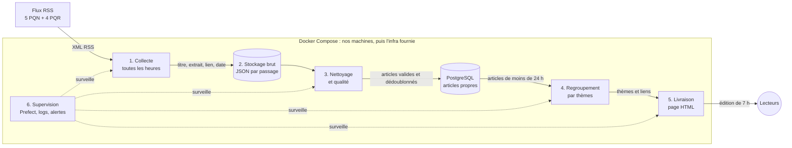

# Note de cadrage — La gazette

## Le besoin
Chaque matin à 7 h, publier une édition qui montre de quoi parle la presse française : les thèmes du jour, les journaux qui les traitent et les liens pour lire la suite. On ne résume pas les articles : on les regroupe par thèmes.

## Périmètre
**Dedans** : 9 sources (5 PQN, 4 PQR) lues par leurs flux RSS publics ; pour chaque article, uniquement le titre, l'extrait, le lien, la date et la source ; le regroupement par thèmes ; une page HTML par jour ; la supervision du pipeline.

**Dehors** : le texte intégral, le scraping des pages, le résumé par LLM, les commentaires, les noms d'auteurs et toute donnée personnelle, un front soigné, les sources payantes.

## Contraintes
- Édition publiée à 7 h (heure de Paris), avec les articles de moins de 24 h.
- Respect des conditions des éditeurs : CGU, `robots.txt` et `/.well-known/tdmrep.json` vérifiés pour chaque source ; une seule requête par flux et par passage ; un User-Agent qui nous identifie.
- Aucune donnée personnelle stockée.
- Budget zéro : nos machines, puis l'infrastructure fournie (TD 4 ou 6).

## Stack retenue et alternatives écartées

| Brique | Choix | Pourquoi | Écarté et pourquoi |
|---|---|---|---|
| Collecte | Python, feedparser, requests | Le RSS est fait pour être lu par des machines ; en-têtes ETag pour ne pas retélécharger | Scraping HTML (hors sujet, fragile) ; API payantes (budget) |
| Ordonnancement | Prefect, auto-hébergé | Relances automatiques, historique des exécutions, interface de suivi | cron seul (ni relance ni historique) ; Airflow (trop lourd pour 9 flux) ; GitHub Actions (horaire planifié non garanti) |
| Stockage brut | Fichiers JSON horodatés par passage | Simple, rejouable en cas de bug | Garder le XML reçu (il peut contenir le texte intégral) |
| Stockage propre | PostgreSQL | URL unique contre les doublons, SQL, standard sur un serveur | DuckDB et SQLite (un seul écrivain à la fois) |
| Qualité | Règles en Python avec pydantic | Contrôles simples et testables | Great Expectations (trop lourd ici) |
| Thèmes | TF-IDF et clustering agglomératif (scikit-learn) | Rapide, sans GPU, explicable ; un thème = ses mots-clés | Embeddings et BERTopic (gardés comme évolution) ; LLM (hors sujet) |
| Livraison | Page HTML statique (Jinja2) servie par nginx | Rien à maintenir, facile à archiver | Application web (hors sujet) |
| Supervision | Logs JSON, interface Prefect, alerte si l'édition n'est pas sortie à 7 h | Couvre le besoin sans infrastructure lourde | Prometheus et Grafana (à réévaluer avec l'infra fournie) |
| Infrastructure | Docker Compose ; Ansible ou Terraform au TD 4-6 selon l'infra | Le même environnement sur chaque machine | Installation à la main |

**Calendrier** : collecte toutes les heures (un flux ne garde que ses derniers articles, un seul passage le matin en raterait), regroupement à 6 h 30, publication à 6 h 45, alerte si rien n'est publié à 7 h.

## Architecture

## Risques
- **Un flux disparaît ou est bloqué** (déjà le cas de La Voix du Nord, écartée car son RSS est bloqué depuis décembre 2025) : 9 sources pour un minimum de 8, une alerte par source, un flux de remplacement prévu (Le Progrès).
- **Conditions des éditeurs** : un éditeur peut s'opposer à la fouille de textes (article L.122-5-3 du CPI), et regrouper des titres par thèmes en est une. Nous vérifions CGU, `robots.txt` et `tdmrep.json`, nous posons la question à l'enseignant et nous ne stockons jamais le texte intégral.
- **Dates manquantes ou fuseaux horaires différents** : tout est converti en UTC ; un article sans date est rejeté.
- **Doublons** (une même dépêche AFP reprise par plusieurs titres) : dédoublonnage par URL et par titre normalisé.
- **Machine éteinte à 7 h** tant que nous sommes en local : risque accepté jusqu'à l'infra fournie.
- **Thèmes peu lisibles** : seuil de regroupement réglé à la main et vérifié sur plusieurs jours.

## Rôles

| Rôle | Qui |
|---|---|
| Sources et collecte | *à compléter* |
| Stockage et qualité | *TRUGUET William* |
| Regroupement par thèmes | *à compléter* |
| Livraison, supervision, infrastructure | Amsellem Ethan-Noé |
